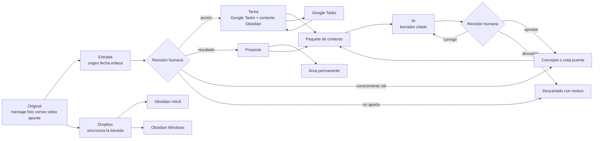
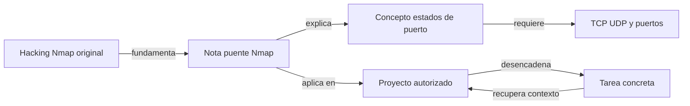
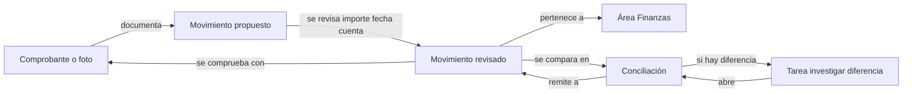

# Plan maestro para construir una Bóveda Personal en Obsidian

## Estado de implementación

> Actualización operativa del 26-11-2026. Este tablero es una síntesis del agente basada en la auditoría; no reemplaza la evidencia ni valida pruebas en cuentas o dispositivos externos.

| Fase | Estado | Evidencia | Fecha de revisión |
| --- | --- | --- | --- |
| 0 · Seguridad y respaldo | bloqueada por decisión | Respaldo requiere cifrado AES y contraseña externa; pyzipper está instalado, falta prueba de restauración. | 2026-11-26 |
| 1 · Modelo de nodos | en implementación | Plantillas normalizadas con frontmatter. | 2026-11-26 |
| 2 · Captura en tres equipos | pendiente de prueba externa | Carpetas y rutas locales preparadas; faltan iPhone, Huawei y conflicto Dropbox. | 2026-11-26 |
| 3 · Tareas con contexto | en implementación | Estados locales y sincronización pendiente definidos; falta prueba Google. | 2026-11-26 |
| 4 · Proyectos y revisión | pendiente de contenido real | Plantilla disponible; falta un proyecto real validado por la persona. | 2026-11-26 |
| 5 · Conocimiento y grafo | pendiente de contenido real | Sin editar Hacking; faltan notas puente revisadas. | 2026-11-26 |
| 6 · IA y contexto | en implementación | Borradores IA y registro técnico delimitados; falta uso real. | 2026-11-26 |
| 7 · Fuentes e integraciones | en implementación | Canales y reglas pasan a archivos revisables; falta curación humana. | 2026-11-26 |
| 8 · Finanzas | bloqueada por datos verificados | No se cargan saldos ni movimientos sin evidencia y decisión de cifrado. | 2026-11-26 |

Fecha de corte: 26 de noviembre de 2026  
Propósito: convertir Obsidian en la base de un sistema personal que conecte trabajo, proyectos, estudio, programación, contenido, libros, mapas conceptuales, apuntes manuscritos, finanzas y tareas. El sistema debe conservar el contexto suficiente para retomar una acción sin reconstruir la historia y debe poder ser usado por personas y por IA sin confundir hechos, borradores y decisiones.

Este documento es la guía completa para planificar, construir, revisar y mantener el sistema. No es una receta para instalar veinte plugins. Cada parte debe aportar una necesidad real, mantenerse legible como Markdown y seguir funcionando aunque el panel, la IA o una integración externa fallen.

---

## 1. Resultado que se busca

Al terminar, una idea, mensaje, video, foto, apunte o correo puede entrar al sistema sin perder su origen. Después se puede convertir, con una decisión humana, en una tarea, un proyecto, un concepto, una fuente, una nota de estudio o un movimiento financiero.

Al abrir una tarea, se debe poder responder de inmediato:

- Qué resultado persigue.
- A qué proyecto o área pertenece.
- Qué se decidió hasta ahora.
- Qué material la fundamenta.
- Cuál es el siguiente paso concreto.
- Qué dato es original, qué fue resumido por IA y qué sigue siendo una duda.

La IA debe recuperar solamente el contexto cercano y pertinente, no leer la bóveda completa. Puede preparar borradores, clasificaciones, resúmenes y conexiones propuestas. La persona revisa antes de convertir cualquier propuesta en información vigente, una tarea, una decisión o un registro financiero.

## 2. Principios que no se negocian

1. La bóveda es la fuente de verdad. El panel es una interfaz sobre archivos locales, no una base de datos paralela.
2. Toda captura conserva origen, fecha y enlace o archivo original cuando exista.
3. Una conexión necesita un motivo. No se enlazan notas por compartir una palabra.
4. Las notas originales de Hacking se conservan. Se conectan mediante índices y notas puente, sin reescribir su historia.
5. Google Tasks representa acciones ejecutables. Obsidian conserva el contexto. Calendar representa compromisos con fecha y hora.
6. Gmail se usa solamente en lectura y clasificación. Nunca se envían, archivan o borran correos desde este sistema.
7. Finanzas trabaja con saldos, movimientos y comprobantes reales. La IA no inventa importes ni realiza operaciones.
8. Los datos creados por una persona y los generados por una automatización o IA se distinguen siempre.
9. Toda automatización deja fecha, resultado, errores y origen para poder auditarla.
10. Cada cambio importante tiene respaldo, prueba y forma de volver atrás.

## 3. Estado real al inicio de esta guía

### Ya existe

- Bóveda real: `D:\Documentos\Boveda Personal`.
- Contenido de Hacking preservado en la bóveda y notas existentes sobre Nmap.
- Obsidian instalado y usado en Windows e iPhone. La tablet Huawei sigue pendiente de prueba completa.
- Sincronización de la bóveda por Dropbox mediante Remotely Save. Dropbox permanece sin cifrado por decisión actual; se debe revisar antes de subir finanzas reales sensibles.
- Panel local en `herramientas/panel.py`, accesible desde Windows por `http://127.0.0.1:4320` y desde dispositivos conectados a Tailscale mediante Serve privado.
- Panel actualizado con una interfaz profesional para escritorio y móvil, recursos CSS y JavaScript separados y Anime.js local para movimiento sutil.
- Integraciones ya conectadas de Google Tasks, Calendar en lectura, Gmail en lectura y YouTube como fuente de investigación.
- Respaldo local verificable. Las credenciales conocidas están excluidas del ZIP.

### No se debe considerar terminado todavía

- La captura y recuperación entre Windows, iPhone y Huawei debe probarse en ambos sentidos.
- Faltan proyectos reales con resultado, decisiones y próximo paso.
- Las tareas todavía necesitan una prueba de ida y vuelta completa con Google Tasks.
- Investigación de YouTube requiere canales aprobados y un proceso humano para curar candidatos.
- Gmail necesita reglas revisables de clasificación, no solo una importación.
- El grafo de conocimiento aún no tiene notas puente reales fuera de Hacking.
- IA con recuperación de contexto, borradores citados y registro de actividad sigue pendiente.
- Finanzas no debe iniciarse hasta cargar saldos reales de diciembre y revisar la política de Dropbox.
- Hay que probar tablet, conflictos de sincronización, fallas de red y recuperación.
- El uso cotidiano necesita semanas de práctica antes de simplificar campos y vistas.

## 4. Arquitectura general



### Capas del sistema

| Capa | Responsabilidad | No debe hacer |
| --- | --- | --- |
| Markdown y adjuntos | Contexto, conocimiento, decisiones, material fuente y trazabilidad | Ocultar datos esenciales solo en una interfaz |
| Obsidian | Edición, lectura, enlaces, búsqueda local y uso sin panel | Convertirse en la fuente de tareas duplicada |
| Panel local | Vistas de trabajo, captura y acciones rápidas | Guardar datos que no existan en la bóveda |
| Google Tasks | Lista ejecutable y recordatorios de acciones | Guardar toda la historia de un proyecto |
| Google Calendar | Eventos, bloques y compromisos con hora | Ser una lista de tareas indefinidas |
| Automatizaciones | Lectura, recolección, clasificación y registro | Cambiar datos sensibles sin evidencia o revisión |
| IA | Recuperar contexto, proponer, resumir y enlazar | Declarar hechos nuevos como confirmados |
| Dropbox | Sincronizar notas y adjuntos elegidos | Ser el único respaldo o una caja de secretos |
| Tailscale | Acceso privado al panel desde móvil | Exponer el panel a Internet pública |

## 5. Estructura de la bóveda

La estructura debe ser pequeña, estable y reconocible. Las carpetas son para ubicar responsabilidades; las relaciones importantes viven en enlaces y frontmatter, no solo en rutas.

```text
Bóveda Personal/
  01 Entrada/              Capturas sin decidir
  02 Proyectos/            Resultados finitos y sus decisiones
  03 Áreas/                Responsabilidades continuas
  04 Conocimiento/         Conceptos, fuentes, libros, mapas y puentes
  05 Diario/               Registro por fecha y revisiones
  06 Tareas/               Contexto de tareas sincronizadas
  07 Adjuntos/             Fotos, PDFs, comprobantes y archivos originales
  08 Automatizacion/       Entradas de colectores y actividad técnica
  Hacking/                 Estudio existente, conservado y enlazado
  datos/                   CSV financieros y datos operativos verificados
  herramientas/            Panel, scripts y configuraciones locales
```

### Reglas de carpetas

- `01 Entrada` no es un archivo muerto. Se revisa y cada elemento termina curado, descartado o convertido.
- `02 Proyectos` contiene esfuerzos con principio, resultado observable y cierre. Una idea suelta no es proyecto.
- `03 Áreas` contiene responsabilidades que no terminan, como Finanzas, Salud, Estudio o Trabajo.
- `04 Conocimiento` no duplica apuntes originales. Crea explicaciones propias, fuentes, índices y puentes cuando aporten conexión.
- `05 Diario` representa observaciones por fecha. No se reescribe el pasado para fingir avance.
- `06 Tareas` solo agrega el contexto que Google Tasks no puede guardar. Cada nota tiene un identificador de la tarea remota cuando existe.
- `07 Adjuntos` conserva el original. Una transcripción u OCR se guarda como borrador separado hasta que se revise.
- `08 Automatizacion` tiene datos de importación, registros y errores que no deben contaminar las notas de estudio.

## 6. Modelo mínimo de nodos y relaciones

Se usa una cantidad mínima de tipos para que la bóveda sea navegable por una persona y fácil de consultar para una IA.

| Tipo | Uso | Estados recomendados |
| --- | --- | --- |
| captura | Idea, enlace, mensaje, foto o documento sin decisión | capturado, por_revisar, curado, descartado |
| fuente | Video, libro, artículo, correo o documento externo | capturado, revisado, archivado |
| concepto | Explicación propia de una idea | borrador, revisado, archivado |
| proyecto | Resultado finito con acciones y decisiones | activo, en_espera, cerrado, archivado |
| area | Responsabilidad continua | activa, en_revision, archivada |
| decision | Elección que cambia el rumbo o evita repetir discusión | vigente, reemplazada |
| tarea | Contexto local de una acción de Google Tasks | pendiente, completada, en_espera, bloqueada |
| borrador_ia | Propuesta que aún no representa conocimiento vigente | por_revisar, aprobada, descartada |
| comprobante | Archivo original que respalda una operación financiera | original, revisado |
| movimiento | Registro financiero revisado | revisado, conciliado, con_diferencia |

### Frontmatter para notas nuevas curadas

```yaml
---
id: con-nmap-estados-puertos
tipo: concepto
estado: revisado
creado: 2026-11-26
origen: "[[Hacking/Temas/Reconocimiento/Nmap]]"
---
```

El identificador permanece aunque cambie el título. No se agrega frontmatter masivo a Hacking sin una razón y revisión previa.

### Relaciones con significado

Las relaciones se escriben en una sección llamada `## Conexiones` y siempre indican por qué existe el enlace.

```markdown
## Conexiones

- Proviene de [[Hacking/Temas/Reconocimiento/Nmap]] porque conserva la explicación de estudio original.
- Requiere [[TCP y UDP]] para interpretar qué significa un puerto y un servicio.
- Aplica en [[Proyecto de práctica autorizado]] cuando exista un entorno seguro y un objetivo definido.
```

Vocabulario inicial: `proviene de`, `explica`, `requiere`, `aplica en`, `documenta`, `desencadena`, `pertenece a` y `contradice`.

No se deben crear conexiones por coincidencia de palabras. Una relación sin explicación es una sugerencia pendiente, no un enlace definitivo.

## 7. Recorridos completos de referencia

### 7.1 Nmap y ciberseguridad

La nota existente de Nmap es evidencia de estudio y contiene enlaces a comandos, scripts, TCP/UDP y subnetting. Debe conservar su contenido y sus aclaraciones sobre qué fue escrito por el estudiante y qué fue ampliación docente.



La nota puente se crea fuera de Hacking, por ejemplo en `04 Conocimiento/Puentes/Nmap en mis proyectos.md`. Antes de hablar de práctica, debe existir un proyecto autorizado, propósito, alcance y entorno seguro. La IA nunca debe deducir que una práctica ocurrió solo porque existe una nota de Nmap.

### 7.2 Finanzas desde diciembre



Una transferencia entre cuentas propias no es ingreso ni gasto. El saldo calculado nunca se ajusta para esconder una diferencia: se registra la diferencia y se crea una tarea para investigarla.

## 8. Plan por fases

Cada fase termina solo cuando se cumplen sus pruebas y la persona acepta avanzar. Instalar algo o escribir código no equivale a terminar una fase.

### Fase 0 Estado seguridad y resguardo

Objetivo: saber qué hay, qué se sincroniza, qué puede contener secretos y cómo volver atrás.

Trabajo:

- Inventariar archivos, plugins, automatizaciones y diferencias entre bóveda real y copias.
- Hacer un respaldo ZIP comprobable fuera de Dropbox.
- Excluir credenciales, configuraciones OAuth y tokens de respaldos y sincronización.
- Mantener Tailscale Serve privado, sin Funnel ni acceso público.
- Documentar qué no se pudo verificar directamente, por ejemplo historial o Papelera de Dropbox.

Aceptación:

- Se abre el ZIP y se comprueba que los adjuntos recientes existen.
- Secretos conocidos no aparecen en el respaldo.
- Se conoce cómo restaurar una copia sin sobrescribir la bóveda activa.

Estado al corte: aceptada con el límite documentado de no haber inspeccionado directamente el historial y Papelera de Dropbox.

### Fase 1 Plano del sistema y modelo de nodos

Objetivo: definir pantallas, recorridos, tipos de notas y relaciones antes de mover conocimiento real.

Trabajo:

- Tomar de los videos de referencia la jerarquía visual: espacios, portadas, tareas, investigación, actividad y separación humano/máquina.
- Diseñar versiones diferenciadas de escritorio e iPhone.
- Definir los tipos de nodo, estados, identificadores y verbos de relación.
- Recorrer Nmap y Finanzas en ida y vuelta sin enlaces ambiguos.

Aceptación:

- Las pantallas responden a una pregunta concreta y muestran estados vacíos honestos.
- Cada flecha del ejemplo Nmap y Finanzas puede justificarse con una fuente.
- El modelo se entiende leyendo Markdown sin Dataview ni IA.

Estado al corte: diseño escrito y frente adelantado para revisión. Falta aceptar el plano global de nodos antes de migrar conocimiento.

### Fase 2 Bóveda y captura en tres equipos

Objetivo: poder capturar texto, enlaces, fotos y PDF desde Windows, iPhone y Huawei sin perderlos.

Trabajo:

- Verificar rutas de adjuntos y creación de notas.
- Crear una plantilla mínima de Entrada que no obligue a completar campos innecesarios.
- Probar ida y vuelta Windows, iPhone y Huawei con texto, foto y PDF.
- Probar un conflicto de Dropbox y su recuperación.
- Documentar qué funciona sin conexión y qué requiere PC encendida.

Aceptación:

- Una nota y foto viajan en ambos sentidos entre los tres equipos.
- Un conflicto se detecta y se recupera sin pérdida.
- Un adjunto se puede encontrar desde su nota original.

### Fase 3 Tareas con contexto

Objetivo: que las tareas no sean recordatorios aislados.

Trabajo:

- Definir qué es tarea, siguiente acción, espera, bloqueo, fecha y prioridad.
- Crear flujo Entrada → tarea → proyecto o área.
- Sincronizar con Google Tasks sin crear duplicados.
- Mostrar Hoy, próximos siete días, sin fecha y en espera.
- Registrar el identificador de Google Tasks en la nota de contexto.

Aceptación:

- Crear, modificar y completar una tarea actualiza ambos lados de manera controlada.
- Abrir una tarea permite recuperar proyecto, decisión y material relevante.
- Una tarea sin fecha no desaparece ni se mezcla con urgencias.

### Fase 4 Proyectos áreas y revisión semanal

Objetivo: retomar trabajo complejo sin reiniciar el pensamiento cada vez.

Trabajo:

- Crear ficha de proyecto con resultado, estado, próximo paso, decisiones, fuentes e historial breve.
- Definir áreas permanentes y su criterio de mantenimiento.
- Diseñar una revisión semanal: procesar Entrada, elegir próximos pasos, detectar bloqueos y registrar decisiones.
- Evitar duplicar la misma tarea en proyecto, diario y Google Tasks.

Aceptación:

- Después de una semana se puede retomar un proyecto leyendo su ficha.
- La revisión semanal convierte entradas y decisiones en acciones concretas.

### Fase 5 Conocimiento y grafo útil

Objetivo: conectar fuentes, conceptos, libros, mapas y notas de estudio sin producir una red decorativa.

Trabajo:

- Crear índices de dominio y notas puente hacia Hacking.
- Usar mapas conceptuales solo cuando aclaran relaciones o procesos.
- Mantener fotografía o manuscrito como original y OCR como borrador separado.
- Añadir conexiones semánticas con verbo y motivo.
- Crear backlinks útiles en índices de estudio y proyectos.

Aceptación:

- Nmap se recorre desde fuente a explicación, mapa, tarea y contexto de vuelta.
- No hay enlaces rotos ni relaciones sin justificación.

### Fase 6 IA y recuperación de contexto

Objetivo: que la IA ayude a retomar y pensar sin inventar memoria.

Trabajo:

- Crear instrucciones por carpeta y alcance.
- Construir paquetes de contexto: pregunta, nodo activo, uno o dos saltos de relaciones, última decisión, fuentes y fechas.
- Separar hechos, inferencias, dudas y propuestas.
- Guardar borradores de IA en una ubicación y estado distinto de las notas vigentes.
- Registrar actividad: consulta, archivos usados, salida, incertidumbres y resultado de revisión.
- Evaluar embeddings solo si búsqueda textual y enlaces cercanos fallan en casos reales.

Aceptación:

- Diez preguntas reales reciben fuentes pertinentes.
- Cuando falta evidencia, la IA lo dice sin completar el hueco con seguridad falsa.
- Una decisión tomada antes puede recuperarse en una sesión nueva.

### Fase 7 Fuentes e integraciones

Objetivo: reunir información útil sin convertir la bóveda en un feed ruidoso.

#### Google Tasks y Calendar

- Tasks: sincronización de acciones, identificadores, fechas, completado y conflictos.
- Calendar: lectura de eventos y compromisos; no crear eventos sin decisión explícita.

#### Gmail

- Solo lectura y clasificación.
- Cada mensaje importado conserva identificador, asunto, remitente, fecha y enlace a Gmail.
- Las categorías se muestran como sugerencias con motivo o regla.
- No se usa para enviar, borrar, archivar, responder ni etiquetar correos automáticamente.

#### YouTube

- Búsqueda por intereses: ciberseguridad, ventas, finanzas, hábitos y foco.
- La vista principal muestra solo videos completos de canales aprobados o fuentes verificadas.
- Excluir Shorts, títulos de baja calidad, canales sin identidad clara y contenido que no aporte al tema.
- Mantener una lista explícita de canales aprobados por tema, idealmente con identificador de canal y justificación.
- Un candidato se puede aprobar, guardar en Entrada o descartar con motivo.
- Un video no se vuelve conocimiento hasta que alguien lo revisa y escribe qué aportó.

Plantilla de fuente aprobada:

```yaml
canal: Nombre del canal
canal_id: Identificador estable si está disponible
tema: ciberseguridad
motivo: Explicaciones técnicas comprobables y videos largos
estado: aprobado
revisado: 2026-11-26
```

#### Instagram y WhatsApp

- Instagram personal y de empresa: usar captura o enlace cuando una integración oficial no aporte valor suficiente.
- WhatsApp personal: captura manual de mensaje, enlace o nota. No se automatiza lectura masiva de conversaciones privadas.

Aceptación:

- Cada elemento importado muestra origen, fecha, enlace y resultado de curación.
- No hay correos modificados ni datos inventados.
- Se puede descartar una fuente y explicar por qué.

### Fase 8 Finanzas verificables

Objetivo: empezar con datos reales desde diciembre y entender cada diferencia.

Trabajo:

- Definir cuentas: Mercado Pago, ARQ, otras billeteras y efectivo.
- Registrar saldos iniciales el 1 de diciembre, en ARS, después de verificarlos.
- Registrar movimientos con fecha, cuenta origen, destino, importe, categoría, descripción y comprobante cuando exista.
- Diferenciar ingreso, gasto y transferencia propia.
- Conciliar semanalmente por cuenta y mensualmente contra presupuesto y objetivos.
- Mostrar discrepancias como tareas de investigación.
- Dejar que IA sugiera categoría o detecte información faltante, sin confirmar ni operar.

Aceptación:

- Saldos cotejados con cada fuente real.
- Transferencias sin doble conteo.
- Diferencias documentadas y sin ajuste manual para simular que todo cuadra.

Antes de iniciar: revisar el riesgo de guardar información financiera sin cifrado en Dropbox. No se requiere cambiar por impulso; se prepara una migración, una copia recuperable y una contraseña administrada por Álvaro si se decide cifrar.

### Fase 9 Frente final

Objetivo: tener una interfaz diaria profesional que refleje datos reales y no esconda el funcionamiento de la bóveda.

Trabajo:

- Mantener una jerarquía clara: Inicio, Tareas, Investigación, Proyectos, Entrada, Finanzas y Actividad.
- Tener diseño específico para escritorio, iPhone y tablet, sin intentar achicar el escritorio hasta que entre en móvil.
- Usar controles táctiles de al menos 44 px, texto legible, contraste suficiente y foco de teclado.
- Usar animaciones suaves solamente para orientar cambios de vista, entrada de contenido y confirmaciones. Respetar reducción de movimiento.
- No usar banners flotantes que tapen el trabajo. El estado de sincronización debe ser pequeño y no invasivo.
- Mostrar estados vacíos honestos: sin tareas, sin proyectos, videos por seleccionar, saldos iniciales pendientes.
- Nunca mostrar métricas falsas, tareas ficticias ni recomendaciones que no fueron curadas.

Aceptación:

- Recorrido real en Windows, iPhone y Huawei.
- Cada control visible hace una acción real o muestra claramente que está pendiente.
- Sin desborde horizontal, botones diminutos ni elementos que dependan solo de hover.

### Fase 10 Operación y recuperación

Objetivo: saber qué pasa cuando algo se corta y cómo recuperarlo.

Trabajo:

- Definir horarios de colectores, sincronización y respaldo.
- Registrar último éxito, error, cantidad procesada y próximos reintentos.
- Crear guía para PC apagada, Tailscale desconectado, OAuth vencido, Internet caído y conflicto de Dropbox.
- Revisar plugins, dependencias y scripts antes de actualizarlos.
- Probar restauración desde respaldo fuera de la bóveda activa.

Aceptación:

- Se simula una falla y se recupera sin pérdida de datos.
- Se entiende qué corre automáticamente y qué necesita intervención humana.

### Fase 11 Uso cotidiano y simplificación

Objetivo: dejar solamente lo que aporta en la vida real.

Rutina de mañana:

1. Abrir Inicio y revisar tareas que requieren atención.
2. Elegir una a tres acciones reales para el día.
3. Consultar Calendar si hay compromisos.

Durante el día:

1. Capturar sin organizar de más.
2. Adjuntar foto o PDF si es la evidencia original.
3. Convertir en tarea solo aquello que requiere acción.

Cierre breve:

1. Marcar tareas completadas o actualizar su estado.
2. Dejar contexto mínimo si una tarea continúa.
3. Procesar capturas importantes o reservarlas para la revisión.

Revisión semanal:

1. Vaciar Entrada.
2. Revisar proyectos sin próximo paso.
3. Revisar tareas sin fecha, bloqueadas o en espera.
4. Revisar fuentes guardadas y borradores IA.
5. Conciliar finanzas cuando corresponda.
6. Registrar decisiones que eviten discutir lo mismo la semana siguiente.

Aceptación:

- Usar el sistema durante dos semanas.
- Eliminar vistas, campos o automatizaciones que no ayuden a capturar, retomar o decidir.

## 9. Diseño de IA seguro y útil

### Qué puede hacer

- Resumir una fuente citando su ruta o URL.
- Extraer preguntas, decisiones y próximos pasos desde material existente.
- Proponer enlaces semánticos y explicarlos.
- Preparar una nota puente o mapa conceptual como borrador.
- Clasificar una captura y señalar información faltante.
- Crear un paquete de contexto para retomar un proyecto.
- Señalar contradicciones entre notas o datos de una conciliación.

### Qué no puede hacer por sí sola

- Declarar que una práctica de ciberseguridad se realizó.
- Reescribir o borrar notas originales de Hacking sin respaldo y revisión.
- Confirmar una transcripción OCR como correcta.
- Crear movimientos financieros con importes deducidos.
- Enviar, borrar, archivar o responder correos.
- Marcar tareas como completas por inferencia.
- Convertir una sugerencia en decisión vigente sin revisión.

### Formato de un borrador de IA

```markdown
---
tipo: borrador_ia
estado: por_revisar
consulta: Qué significa filtered en mis apuntes de Nmap
creado: 2026-11-26
fuentes:
  - [[Hacking/Temas/Reconocimiento/Nmap]]
---

## Respuesta propuesta

...

## Hechos citados

- ...

## Inferencias y dudas

- ...

## Cambios propuestos

- ...
```

## 10. Seguridad privacidad y acceso

### Acceso al panel

- Windows: usar `http://127.0.0.1:4320` desde la PC que ejecuta el panel.
- Móviles: usar Tailscale y Serve privado, sin Funnel público.
- El panel puede permanecer sin contraseña adicional por decisión de Álvaro, pero debe restringir Host y Origin, escuchar solo en localhost y no habilitar CORS abierto.
- Revisar qué dispositivos pertenecen a la red de Tailscale y retirar los que ya no se usen.

### Credenciales

- OAuth, secretos de cliente, tokens y configuraciones de Dropbox se guardan fuera de la bóveda.
- No copiar secretos a notas, adjuntos, respaldo ni capturas.
- Al rotar una clave o regenerar OAuth, comprobar qué procesos y dispositivos necesitan reconectar.

### Dropbox y cifrado

- Sin cifrado de Remotely Save, las notas y adjuntos subidos quedan legibles para el proveedor de almacenamiento según su servicio y configuración.
- Antes de cargar finanzas reales o material sensible, decidir entre mantener la situación actual o migrar a cifrado.
- Una migración a cifrado debe tener: copia local verificable, inventario remoto, contraseña recuperable, prueba en una copia y plan de retorno.

### Adjuntos

- Las fotos de apuntes y comprobantes son fuentes originales y pueden contener datos sensibles.
- Guardar solo lo necesario, nombrar con criterio y no publicar enlaces públicos.
- Eliminar un adjunto requiere revisar backlinks y confirmar que existe un respaldo si corresponde.

## 11. Sincronización entre dispositivos

| Dispositivo | Uso principal | Requisito | Prueba mínima |
| --- | --- | --- |
| Windows | Edición profunda, scripts, panel, respaldo | Dropbox y panel local | Crear nota, adjunto y tarea; confirmar en móvil |
| iPhone | Captura, consulta, fotos y tareas rápidas | Obsidian, Dropbox, Tailscale para panel | Crear foto y nota; confirmar en Windows |
| Huawei | Consulta, captura y mapas | Obsidian, Dropbox, Tailscale si usa panel | Editar nota y confirmar en Windows/iPhone |

Reglas prácticas:

- Esperar a que una sincronización termine antes de editar el mismo archivo en dos dispositivos.
- Si aparece conflicto, conservar ambas versiones, entender el cambio y luego consolidar manualmente.
- El panel requiere PC encendida para verse desde el teléfono por Tailscale. Obsidian y Dropbox pueden seguir sirviendo para leer notas sincronizadas aunque el panel esté apagado.
- No usar Dropbox como único respaldo: un conflicto sincronizado también puede propagarse.

## 12. Pruebas obligatorias antes de llamar terminado a algo

### Bóveda y enlaces

- Enlaces internos existentes abren su destino.
- No hay enlaces a archivos borrados o rutas antiguas.
- Adjuntos se abren desde iPhone y Windows.

### Tareas

- Crear tarea desde panel y localizar su nota de contexto.
- Cambiar o completar una tarea y comprobar el resultado en Google Tasks.
- Detectar cómo se resuelve una edición simultánea o fallo de red.

### Panel

- Escritorio: cada ruta funciona y no hay errores en consola.
- iPhone: 390 px sin scroll horizontal global y botones de al menos 44 px.
- Tablet: layout legible sin tener que hacer zoom.
- Estados vacíos y errores explican qué falta.

### Fuentes

- Gmail se lee pero no se modifica.
- YouTube no muestra Shorts ni fuentes sin aprobar como recomendaciones.
- Un video curado conserva URL, canal, tema y decisión de uso.

### Finanzas

- No se puede guardar saldo, movimiento o conciliación sin confirmación explícita.
- Transferencia propia no altera ingreso/gasto neto.
- Diferencia de conciliación se conserva y genera una acción de investigación.

### Recuperación

- Restaurar copia en ubicación separada.
- Probar panel caído, OAuth vencido y Dropbox sin conexión.
- Verificar que el estado de error sea visible y no simule datos actuales.

## 13. Cómo decidir si agregar una herramienta

Antes de instalar un plugin, script, integración o servicio, responder:

1. Qué problema concreto resuelve.
2. Qué archivo, dato o permiso necesita.
3. Qué pasa si deja de funcionar.
4. Qué alternativa manual existe.
5. Cómo se respalda o revierte.
6. Qué dispositivo lo necesita.
7. Cuánto ruido agrega a la captura, búsqueda o revisión.
8. Cómo se medirá si realmente ahorra tiempo o reduce repetición de contexto.

No se instala una herramienta solo porque tenga un dashboard atractivo o una promesa de IA. La complejidad se justifica cuando resuelve un caso de uso repetido.

## 14. Registro de decisiones importantes

| Decisión | Estado actual | Cuándo revisarla |
| --- | --- | --- |
| Bóveda nueva con Hacking | Aprobada y operativa | Al crear las primeras notas puente |
| Hacking | Conservar originales y enlazar | Antes de cualquier migración o renombre masivo |
| Primer recorrido de conocimiento | Nmap | Al completar Fase 5 |
| Tareas | Google Tasks con contexto en Obsidian | Al probar sincronización bidireccional |
| Calendar | Lectura de agenda | Si se decide crear eventos desde el sistema |
| Gmail | Solo lectura y clasificación | Al definir reglas de clasificación |
| YouTube | Intereses, no analítica de canal propio | Al aprobar canales por tema |
| Instagram | Personal y empresa, según valor real | Antes de conceder permisos de Meta |
| WhatsApp | Captura manual inicial | Solo automatizar si el flujo manual falla repetidamente |
| Panel móvil | Tailscale privado | Si cambia la red de dispositivos |
| Dropbox | Sin cifrado por ahora | Antes de cargar finanzas reales |
| IA | Borradores separados y revisión humana | Al entrar en Fase 6 |

## 15. Criterio final de éxito

El sistema está bien armado cuando se cumplen estas condiciones en uso real:

- Una captura tarda segundos y no exige decidir todo en el momento.
- Una tarea lleva al contexto suficiente para actuar sin buscar durante diez minutos.
- Un proyecto se puede retomar después de una semana.
- Las notas de estudio originales se mantienen respetadas y conectadas a usos reales.
- La IA cita lo que usa, expresa dudas y no deja decisiones escondidas.
- La investigación trae pocas fuentes que valen la pena en vez de un feed infinito.
- Las finanzas se pueden conciliar y una diferencia tiene explicación o tarea pendiente.
- El mismo sistema se siente usable en Windows, iPhone y tablet.
- Si se apaga una integración, la información esencial sigue siendo Markdown, archivos y respaldos que se pueden abrir.
- Después de dos semanas de uso se pueden eliminar pasos sobrantes sin perder claridad.

## 16. Próximo orden recomendado

1. Revisar y aceptar el modelo de nodos y los ejemplos de Nmap y Finanzas.
2. Completar la prueba de sincronización Windows, iPhone y Huawei.
3. Probar tareas con un proyecto real pequeño y una semana de contexto.
4. Elegir canales de YouTube aprobados por cada tema.
5. Crear las primeras notas puente desde Hacking, sin editar los originales.
6. Diseñar los paquetes de contexto y borradores de IA.
7. Iniciar finanzas el 1 de diciembre con saldos iniciales verificados.
8. Simular fallas, probar respaldo y empezar dos semanas de uso cotidiano.

La prioridad no es completar todas las pantallas. La prioridad es que cada acción importante conserve su origen, contexto y próximo paso, y que el sistema se vuelva más simple de usar cuanto más tiempo pasa.

