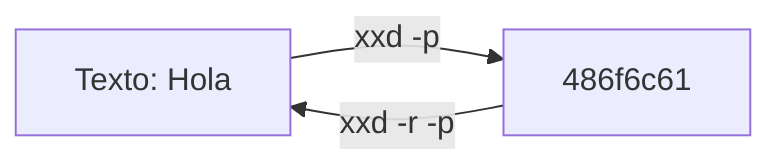

# Bytes y hexadecimal

## Ida y vuelta


Cada par hexadecimal representa un byte: `48` → H, `6f` → o, `6c` → l, `61` → a (ASCII/UTF-8 para estas letras). Es una representación, no cifrado.

```bash
printf 'Hola' | xxd -p
printf '486f6c61' | xxd -r -p
```

Resultados: `486f6c61` y `Hola`. `printf 'Hola'` no agrega salto final: no aparece el byte `0a`. `-p` usa hexadecimal simple; `-r` revierte. Fuente: [manual de xxd](https://manpages.debian.org/bookworm/xxd/xxd.1.en.html).

**Probate:** ¿por qué `printf 'Hola\n' | xxd -p` termina en `0a`?
