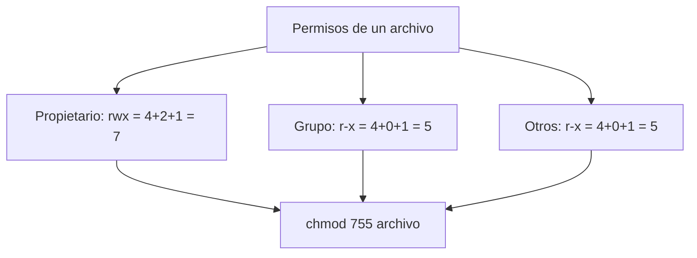

# Permisos visuales

## Del símbolo al número

## Explorador
Abrí [[Recursos Visuales/linux-permisos.html|Explorador de permisos]] con un navegador (desde el explorador de archivos si Obsidian no lo abre). La incrustación HTML en Obsidian queda pendiente de identificar el plugin de tu prueba.

1. Cargá **755**: observá `rwxr-xr-x`.
2. Cambiá a **644**: `rw-r--r--`; nadie tiene ejecución.
3. Elegí **Directorio**: `x` pasa a significar recorrer/buscar, no ejecutar un programa.
4. Cambiá un permiso y anticipá el dígito antes de mirar el resultado.

El explorador calcula los nueve bits básicos, no el acceso efectivo de un usuario: faltan ACL, bits especiales, privilegios, montaje y permisos en directorios de la ruta. Fuente: [chmod](https://manpages.debian.org/bookworm/coreutils/chmod.1.en.html).
