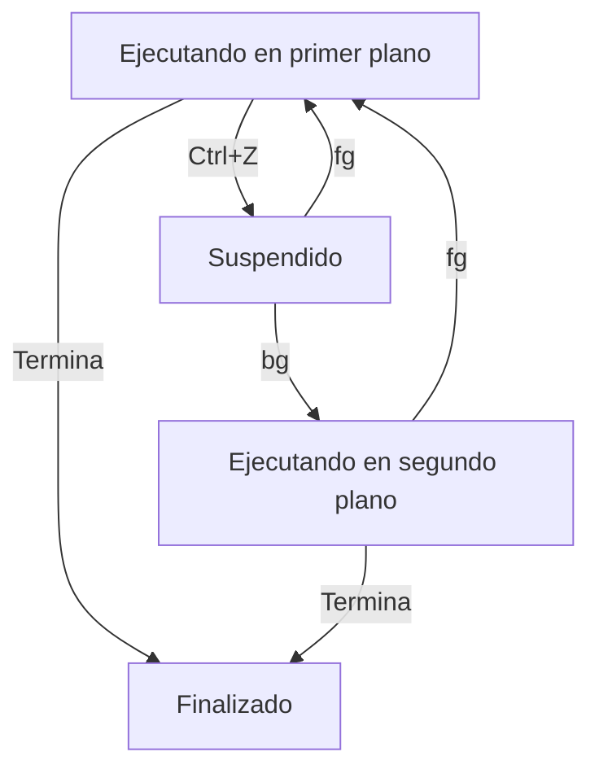
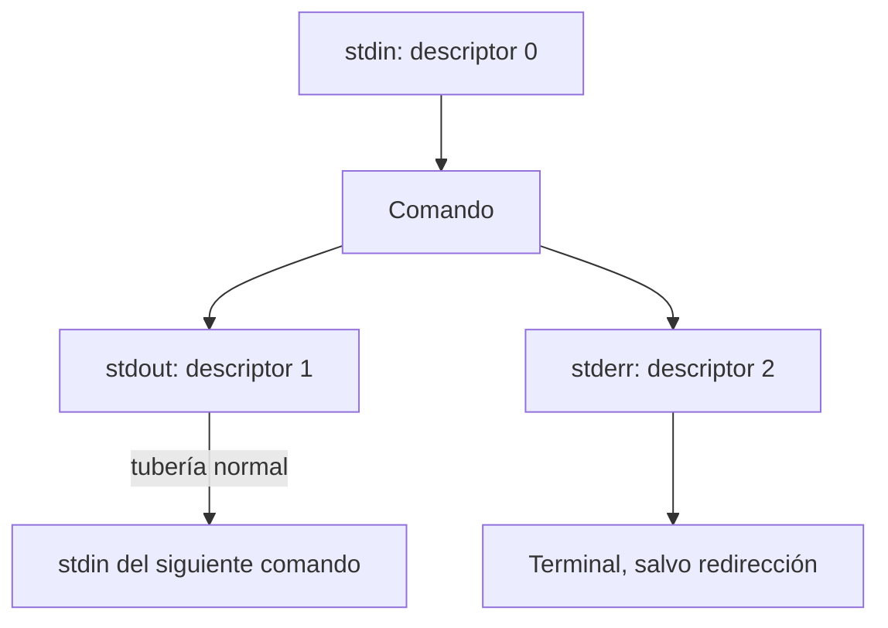

# Procesos y flujos

## Estados del trabajo en Bash

Se muestra control de trabajos en una terminal interactiva, no todos los estados del planificador Linux. `jobs` lista los trabajos de esa shell. Fuente: [Bash, JOB CONTROL](https://manpages.debian.org/bookworm/bash/bash.1.en.html#JOB_CONTROL).

## Tres canales

Probá mentalmente: si un comando falla, ¿`| wc -l` contará necesariamente el error? No: la tubería normal transporta stdout. Véase [[Temas/Linux/07_Texto_y_tuberias_Gemini]].
