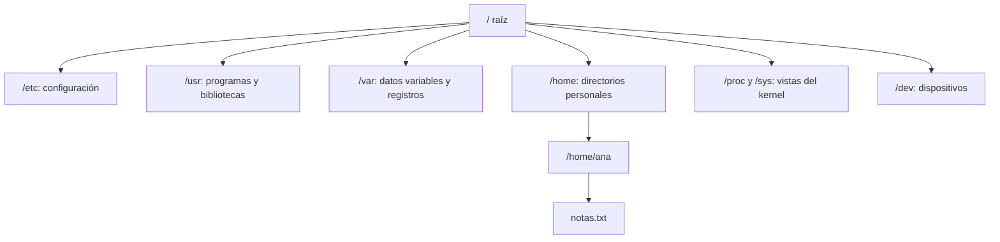

# Rutas y directorios

## Árbol de referencia

Ejemplo didáctico: suponé que estás en `/home/ana`. `notas.txt` es una ruta relativa; `/home/ana/notas.txt` es absoluta y apunta al mismo archivo. `pwd` muestra el directorio de trabajo; `cd ..` sube a `/home`. Para regresar al directorio anterior se usa `cd -` (no equivale siempre a subir).

**Probate:** desde `/home/ana`, ¿a dónde lleva `../otra`? A `/home/otra`, si existe y tenés permiso para recorrer la ruta.

La forma de organizar archivos no garantiza que todos esos directorios existan o sean discos distintos. Fuente: [FHS 3.0](https://refspecs.linuxfoundation.org/FHS_3.0/fhs/index.html).
