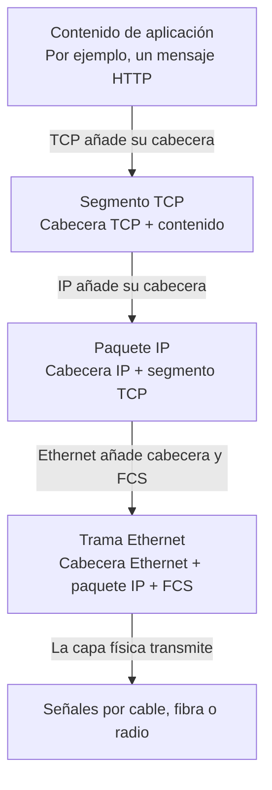
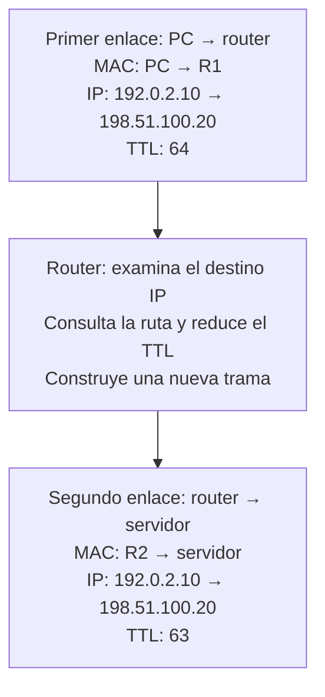
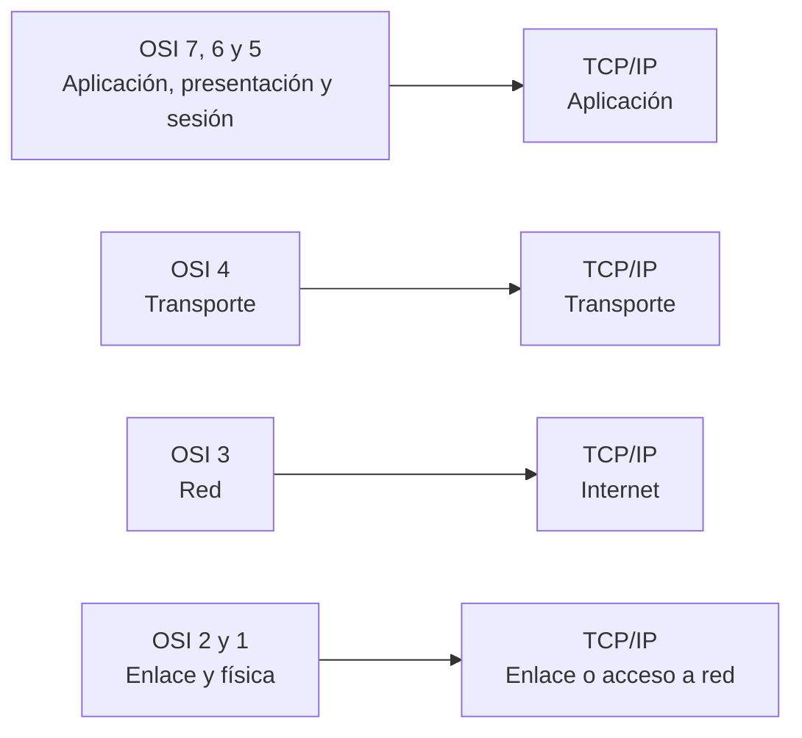

# OSI: recorrido de los datos

Diagramas de la ampliación del 2026-09-11, para [[Temas/Conceptos basicos/Modelo OSI#Modelo OSI: ordenar lo que ya aprendiste]]. Complementan el mapa de siete capas existente; no representan una captura real de tráfico.

## Encapsulación paso a paso

Cada envoltura transporta lo anterior. **FCS** es una comprobación de errores de la trama. Al recibir, se interpretan y retiran las envolturas correspondientes. En HTTPS sobre TCP, TLS protege el mensaje HTTP antes de transportarlo por TCP. Se omiten opciones, segmentación y fragmentación para concentrarnos en las capas.

## Qué cambia al pasar por un router

**R1 y R2** representan las MAC de dos interfaces diferentes del router. Es un ejemplo IPv4 con dos enlaces Ethernet, un router y sin NAT, túneles ni fragmentación. El servidor está directamente conectado al segundo enlace. Las IP de los extremos permanecen; las cabeceras de enlace cambian y el paquete IP también cambia en campos como TTL y su checksum.

## OSI y TCP-IP

Correspondencia didáctica aproximada con la representación de **cuatro capas** de TCP/IP. Algunos cursos separan física y enlace y muestran cinco. Las funciones no desaparecen por agruparlas de otra manera.
