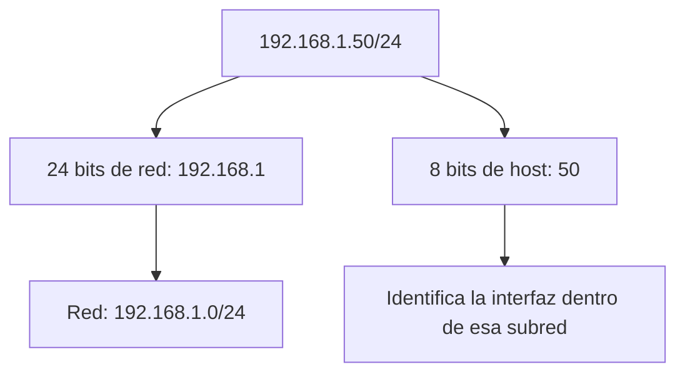
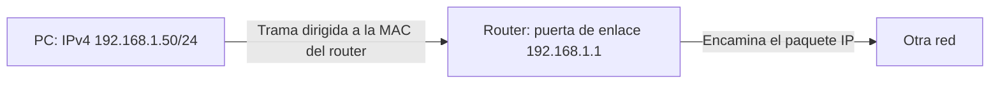

# Redes: IPv4, IPv6 y MAC

Relacionado: [[Temas/Conceptos basicos/Conceptos Basicos]]. Complemento didáctico de tus notas; el original se conserva.

## IPv4: cuatro octetos
Una IPv4 tiene 32 bits: cuatro grupos de 8 bits. Cada octeto se escribe en decimal de 0 a 255.

| Decimal | 192 | 168 | 1 | 50 |
| --- | --- | --- | --- | --- |
| Binario | 11000000 | 10101000 | 00000001 | 00110010 |
| Tamaño | 8 bits | 8 bits | 8 bits | 8 bits |



En este ejemplo, la máscara es `255.255.255.0`. La división depende de `/24`; con otro prefijo puede caer dentro de un octeto. Estar conectado al mismo router no obliga a pertenecer a la misma subred.

## IPv6: ocho grupos en la forma completa
Tiene 128 bits. Su representación completa contiene ocho grupos hexadecimales de 16 bits, separados por `:`.

```text
2001:0db8:0000:0000:0000:0000:0000:0050
2001:db8::50
```

Ambas formas representan la misma dirección. Se pueden omitir ceros iniciales y usar `::` una vez para sustituir grupos consecutivos de ceros. Fuente: [RFC 4291, representación textual](https://www.rfc-editor.org/rfc/rfc4291#section-2.2).

## MAC: dirección de enlace
Una MAC Ethernet de 48 bits se suele escribir como seis pares hexadecimales: `02:11:22:33:44:55`. Cada par son 8 bits.

La dirección del ejemplo es administrada localmente. No se debe interpretar `02:11:22` como fabricante. En direcciones universales con asignación OUI clásica, los primeros 24 bits identifican la organización asignataria; esa división no es una regla para todas las MAC.

## Cómo se relacionan


Para un destino fuera de la subred, la PC usa normalmente la MAC de la puerta de enlace como destino de la trama. La IP de destino del paquete sigue siendo la del destino remoto, salvo traducciones como NAT. ARP permite resolver IPv4 a MAC en el enlace local; IPv6 utiliza Neighbor Discovery.

## Repaso
- ¿Cuántos bits hay en un octeto? **8**.
- ¿IPv6 es una MAC más larga? **No: tienen funciones diferentes**.
- ¿En toda IPv4 los tres primeros números son la red? **No: depende del prefijo**.
- ¿Una MAC demuestra quién es una persona? **No**.

Abrí [[Recursos Visuales/Mapa de estudio.canvas]] para mover y conectar los conceptos.


## Explorador IPv4 — añadido 2026-09-09
Abrí [[Recursos Visuales/redes-ipv4.html|IPv4: cambiar el prefijo]] en un navegador. La incrustación HTML está pendiente de identificar el plugin.

1. Partí de `192.168.1.50/24`: red `192.168.1.0`, máscara `255.255.255.0`.
2. Cambiá a `/26`: red `192.168.1.0`, broadcast `192.168.1.63`.
3. Cambiá a `/27`: red `192.168.1.32`, broadcast `192.168.1.63`. Mirá dónde cae el corte dentro del último octeto.
4. Probá `/31` y `/32`: el recurso indica sus casos especiales, sin aplicar siempre “total menos dos”.

El explorador calcula prefijos, no determina si tu red real está configurada así. Fuente: [CIDR, RFC 4632](https://www.rfc-editor.org/rfc/rfc4632).

El caso `/31` corresponde a enlaces punto a punto: [RFC 3021](https://www.rfc-editor.org/rfc/rfc3021).
