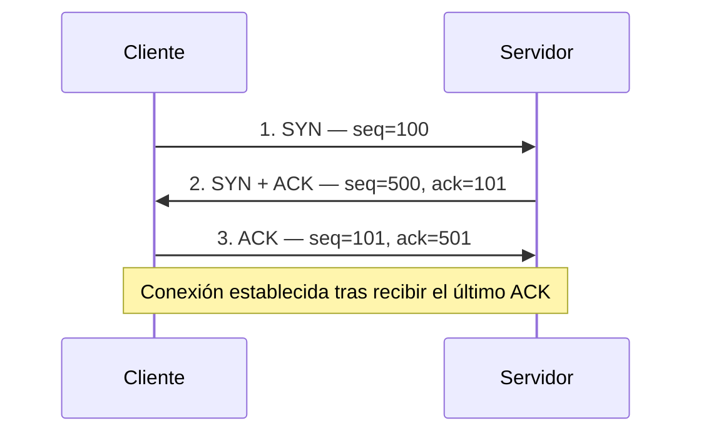
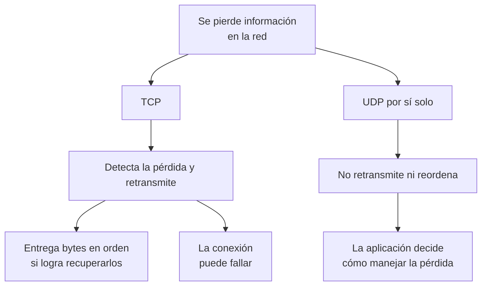
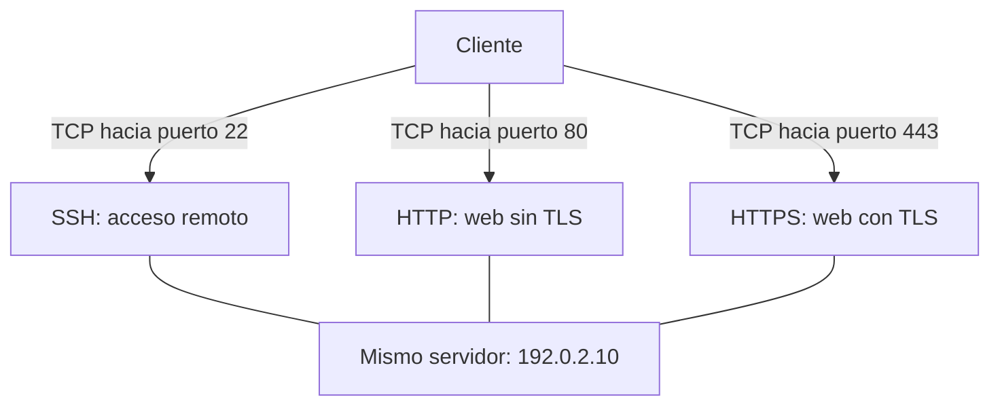
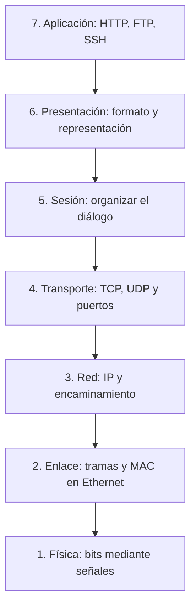
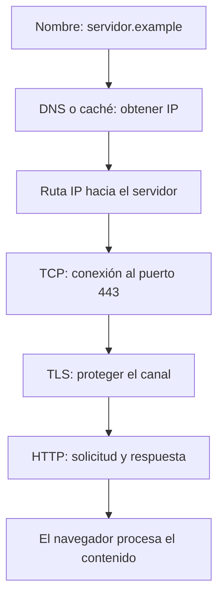

# Redes: TCP, UDP, puertos y OSI

Recursos para [[Temas/Conceptos basicos/Conceptos Basicos]]. Diagramas añadidos el 2026-09-11 a partir de tus capturas y la revisión técnica. Son esquemas de estudio, no capturas de tráfico real.

## Handshake TCP

Leé de arriba hacia abajo. Los números son inventados para aprender: cada extremo elige su secuencia inicial. El SYN ocupa una posición; por eso se confirma con **+1**. Este ejemplo no lleva datos en el handshake.

## TCP y UDP ante una pérdida

**Ejemplo:** si falta una parte de un archivo, TCP puede recuperarla. En audio en vivo, la aplicación puede preferir continuar antes que reproducir una parte demasiado tarde. El comportamiento depende de la aplicación; no todo audio o video usa UDP.

## Una IP, distintos puertos

Es un servidor de ejemplo con tres servicios configurados. La **IP** identifica el destino de red; el **puerto** permite distinguir servicios. Este dibujo usa TCP; HTTPS también puede usar HTTP/3 sobre QUIC/UDP.

## Las siete capas OSI

Al **enviar**, seguí las flechas hacia abajo; al **recibir**, recorré las capas hacia arriba. OSI organiza funciones: los protocolos reales de Internet no encajan siempre de forma exacta en siete piezas separadas.

## Del nombre a la página

Ejemplo de HTTPS sobre TCP, sin conexiones previas reutilizables. Las flechas indican el orden conceptual, no tiempos medidos. HTTP/3 usa QUIC/UDP y tiene otro establecimiento.
