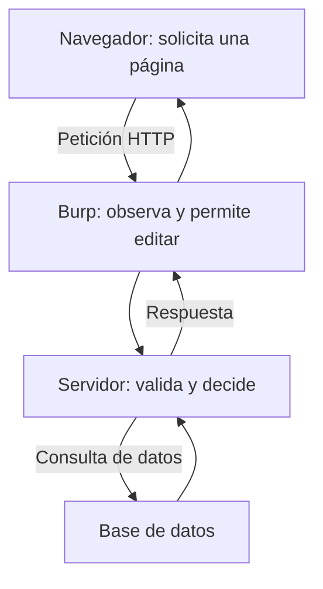
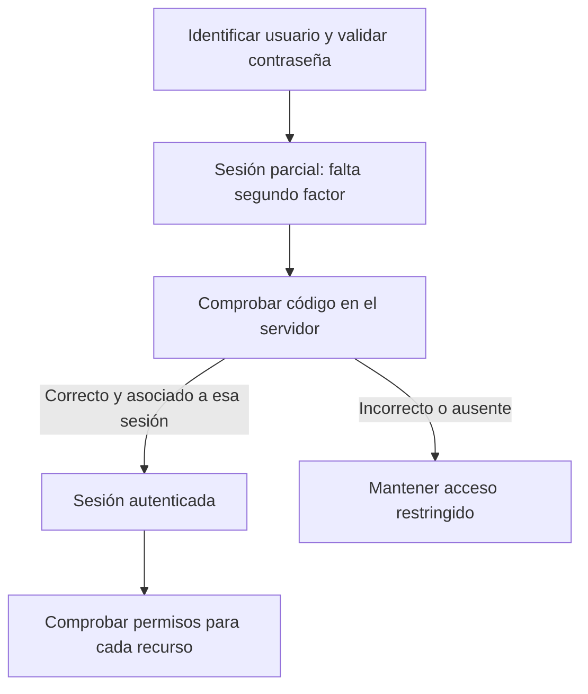

# Seminario · límites de confianza

Recurso didáctico del asistente, 20/10/2026. Complementa la clase; no reproduce un diagrama del docente. Una **frontera de confianza** es el lugar donde un sistema recibe datos que debe comprobar antes de usarlos.

## Qué permite ver el proxy

Burp ocupa ese lugar porque el navegador del laboratorio está configurado para usarlo como proxy. No aparece automáticamente en cualquier conexión. El servidor debe tratar lo recibido del navegador como datos no confiables: alguien puede cambiar cabeceras, campos y rutas.

## Una pantalla de código no basta

Es el comportamiento seguro simplificado, no una descripción del código interno del laboratorio. Un fallo de implementación puede permitir llegar al recurso protegido sin completar el segundo factor. Ocultar el botón o cambiar la pantalla no corrige ese fallo.

Fuentes de la ampliación: [Burp Proxy](https://portswigger.net/burp/documentation/desktop/tools/proxy/intercept-messages) y [autenticación multifactor](https://portswigger.net/web-security/authentication/multi-factor), consultadas el 20/10/2026. Relación con tus redes: [[Temas/Conceptos basicos/Conceptos Basicos]].
